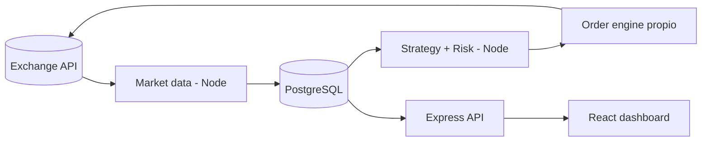
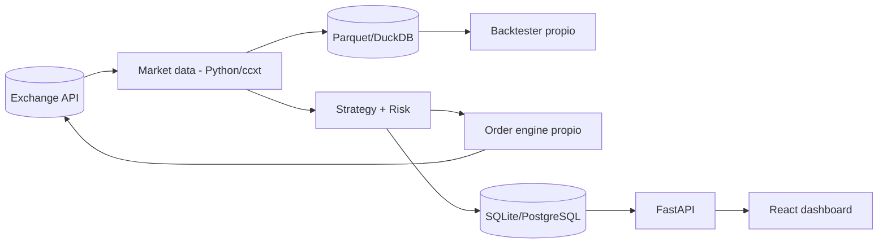
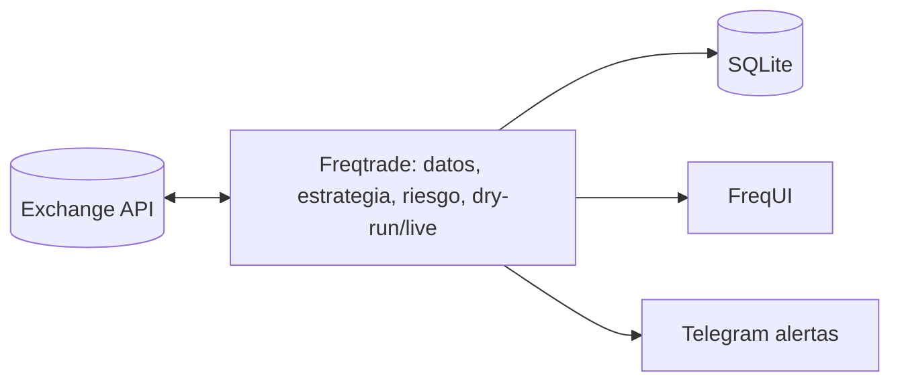
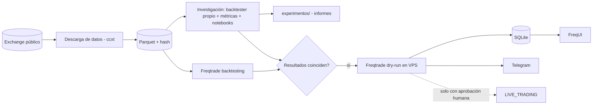
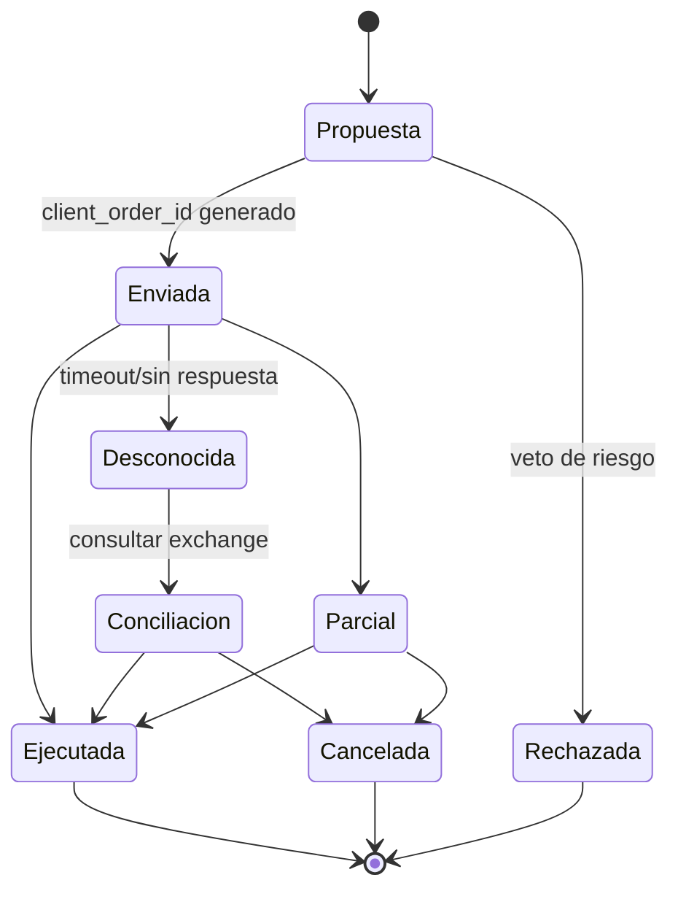
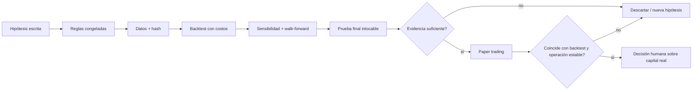

# Diagramas de arquitectura

**Actualizado:** 2026-11-04 · Renderizan en GitHub y en VS Code (extensión Mermaid).

## Alternativa A — TypeScript completo

## Alternativa B — Python + React (motor propio)

## Alternativa C — Framework existente

## Alternativa D — C + investigación propia (opción preferente, sujeta a PoC)

## Flujo de estados de una orden (diseño)

## Pipeline de validación de estrategias

