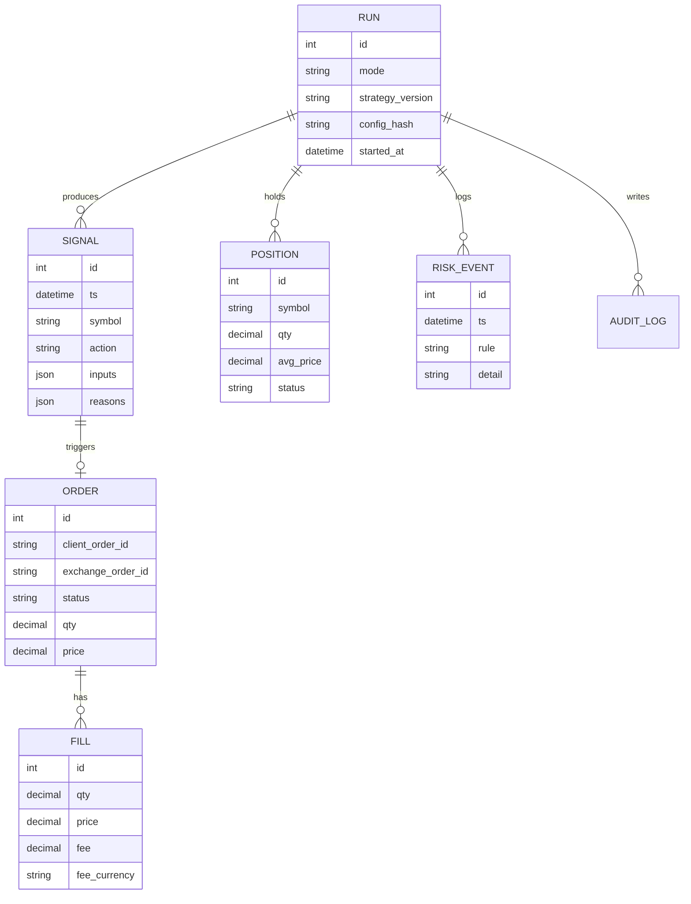

# 08 — Arquitectura (borrador condicionado a la PoC)

**Objetivo:** definir una arquitectura simple para un proyecto individual.
**Actualizado:** 2026-11-04
**Estado:** 🟡 Borrador. Se finaliza en la fase 4 tras la PoC ([07](07-evaluacion-tecnologias.md)).

## Resumen

Dos procesos principales más una capa de investigación:

1. **Bot** (motor de datos + estrategia + riesgo + ejecución/paper): proceso aislado, único con credenciales de trading.
2. **API/Dashboard** (solo lectura sobre el estado): sin acceso a claves de trading; si se permite "kill switch" desde la UI, se implementa como archivo/flag que el bot lee, no como acceso al exchange.
3. **Investigación** (notebooks + scripts): offline, sobre Parquet; no tiene claves.

Sin microservicios, sin colas. Comunicación vía base de datos/archivos.

## Distribución de módulos

| Módulo | Dónde vive | Notas |
|---|---|---|
| Market Data Service | Bot (o Freqtrade) | Descarga, valida (gaps, duplicados, vela abierta) |
| Historical Data Storage | Parquet + DuckDB | Dataset versionado con hash |
| Indicator Engine | Biblioteca compartida | Misma función en backtest y vivo |
| Strategy Engine | Biblioteca compartida | Función pura: datos → señal + razones |
| Risk Management Engine | Biblioteca compartida + guardia en el bot | Veto sobre toda orden; límites y kill switch |
| Backtesting Engine | Investigación (propio) y Freqtrade | Dos motores para contrastar |
| Paper Trading Engine | Freqtrade `dry-run` o propio | Datos reales, sin órdenes reales |
| Order Execution Engine | Bot | Solo activo en `LIVE_TRADING` |
| Portfolio Management | Bot | Estado conciliado con el exchange |
| Trade History | SQLite | Con auditoría |
| Monitoring & Alerts | Bot + Telegram/email | Heartbeat, errores, límites |
| Configuration Management | Archivos versionados + variables de entorno | Secretos fuera del repo |
| Dashboard API / UI | FreqUI o API propia | Ver [12](12-dashboard.md) |

## Modos de operación

| Modo | Datos | Órdenes | Claves de API | Por defecto |
|---|---|---|---|---|
| `BACKTEST` | Históricos | Simuladas | No | ✅ |
| `PAPER_TRADING` | Reales | Simuladas | **Solo lectura/ninguna** | ❌ |
| `LIVE_TRADING` | Reales | Reales | Trade-only, sin retiros | ❌ **Deshabilitado** |

Activar `LIVE_TRADING` exige (todas): (1) variable `ALLOW_LIVE=true` + (2) archivo de aprobación firmado con fecha y límites + (3) confirmación manual en el arranque + (4) capital máximo codificado + (5) reconciliación inicial exitosa. Cualquier fallo → arranca en `PAPER_TRADING`.

## Registro de decisiones

Cada señal/orden guarda: timestamp, versión de código y config (hash Git), datos de entrada (últimas velas), valores de indicadores, regla activada, resultado del chequeo de riesgo, y respuesta del exchange. Permite responder "¿por qué compró?".

## Modelo de base de datos (operacional, borrador)



Todos los importes en `Decimal`/texto, nunca `float`, para dinero.

## Endpoints (borrador, solo lectura)

`GET /status` · `GET /positions` · `GET /trades?mode=` · `GET /equity` · `GET /risk/events` · `GET /experiments` · `GET /experiments/{id}` · (acción protegida) `POST /killswitch`.

## Estructura de carpetas de código (provisional)

```text
src/
├── research/        # notebooks, backtester propio, métricas
├── strategies/      # estrategias versionadas (usables en ambos motores)
├── common/          # indicadores, riesgo, tipos
├── data/            # descarga, validación, parquet
├── bot/             # configuración Freqtrade o motor propio
├── api/             # (opcional) FastAPI de lectura
├── dashboard/       # (opcional) React
└── tests/
```

## Estrategia de pruebas

Unitarias (indicadores con casos conocidos, riesgo, redondeos) · pruebas de propiedades (no look-ahead: el resultado en t no cambia si se alteran datos > t) · pruebas de integración con exchange simulado · pruebas de reinicio/duplicación · regresión de backtests (mismos datos+config ⇒ mismo resultado).

## Riesgos / Próximos pasos

- Riesgo: sobrearquitectura. Regla: solo se crea un componente cuando el roadmap lo requiere.
- [ ] Finalizar tras ADR-0003 (semana 5)

## Fuentes

Diseño propio. Ver [diagramas](../arquitectura/diagramas.md).

## Enlaces relacionados

[07](07-evaluacion-tecnologias.md) · [09](09-desarrollo.md) · [14](14-seguridad.md)
